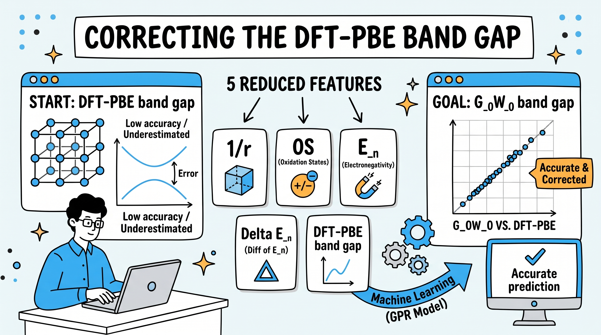

### Overview of the Research
In our paper published in *Computational Materials Science*, we developed a physics-guided machine learning framework to address one of the most persistent bottlenecks in computational materials discovery: the systematic band gap underestimation inherent in Density Functional Theory using the Perdew–Burke–Ernzerhof functional (DFT-PBE) .

While high-throughput screening relies on DFT-PBE for its computational speed and structural reliability, accurate electronic property predictions typically demand many-body perturbation theory ($$G_0W_0$$). However, the extreme computational cost of $$G_0W_0$$ makes screening large crystal repositories practically infeasible. Our goal was to bridge this gap by boosting standard PBE calculations to near-$$G_0W_0$$ precision using a minimal, physically grounded feature set .

---

### The Problem: Why a Reduced Feature Set?
Many machine learning models designed to predict or correct band gaps rely on extensive descriptor collections (often 16 to over 40 features) or are restricted to narrow chemical spaces (such as 2D monolayers or oxide perovskites). These approaches suffer from two main drawbacks:

1. **Loss of physical interpretability**: Large feature spaces often obscure the fundamental mechanisms driving the correction.
2. **Computational overhead**: Many complex descriptors require additional, demanding electronic calculations.

To solve this, we focused on identifying a compact set of descriptors directly linked to Coulombic interactions within crystal lattices, avoiding redundant or computationally expensive features .

---

### The Five Physics-Guided Descriptors
Through feature correlation and ranking, we condensed the feature space down to just **five parameters** that can be obtained directly from standard PBE output or elementary periodic table data without any extra atomistic calculations :

1. **PBE Band Gap ($$E_{g,\text{PBE}}$$ )**: The baseline value to be corrected.
2. **Average Inverse Atomic Distance ($$1/r$$ )**: Calculated from the unit-cell volume divided by the number of atoms, representing characteristic electrostatic interaction strength.
3. **Average Oxidation State (OS)**: The mean magnitude of atomic formal oxidation states, capturing ionic charge magnitude.
4. **Average Electronegativity ($$E_n$$ )**: Gauging atomic electron attraction across the crystal.
5. **Minimum Electronegativity Difference ($$\Delta E_n$$ )**: Capturing the charge transfer and polarity between oppositely charged constituents.

---

### Key Findings and Performance
We evaluated 16 regression algorithms across a benchmark dataset of **265 inorganic semiconductors and insulators** (including ternary, equiatomic binary, and non-equiatomic binary crystals) covering band gaps from 0.75 eV up to 14.55 eV :

* **High Accuracy with Gaussian Process Regression**: Our top model—Gaussian Process Regression (GPR) with a Matérn 3/2 kernel—achieved a cross-validation Root-Mean-Square Error (**RMSE**) of **0.252 eV** and an **$$R^2$$ of 0.9932** .
* **Strong Linear Baselines**: Even a standard multilinear regression model yielded an RMSE of **0.330 eV**, confirming that the selected five descriptors inherently capture the underlying physical relationships rather than relying on nonlinear mathematical artifacts .
* **Unbiased Residuals**: The prediction errors follow a normal distribution centered at zero mean:

$$
\mu = 0\text{ eV}, \quad \sigma = 0.245\text{ eV}
$$

demonstrating negligible systematic error .
* **External Database Validation**: Testing against independent structures from the AFLOW repository matched with NREL MatDB $$G_0W_0$$ values demonstrated that the model generalized well, cutting raw PBE errors from 1.89 eV down to 1.03 eV out-of-the-box (and 0.68 eV upon retraining) .

---

### Practical Impact
By pairing standard PBE calculations with this 5-descriptor ML model, researchers can achieve near-quasiparticle ($$G_0W_0$$) accuracy at the speed and throughput of standard DFT. This provides a practical, low-cost framework for large-scale materials screening and rapid exploration of compositional trends across diverse crystal systems.

For full technical details, training parameters, and cross-validation benchmarks, check out our published paper .

---

### References

 Ibnu Jihad, Miftah Hadi S. Anfa, Saad M. Alqahtani, and Fahhad H. Alharbi, *"DFT-PBE band gap correction using machine learning with a reduced set of features,"* **Computational Materials Science**, vol. 244, p. 113153, 2024. [https://doi.org/10.1016/j.commatsci.2024.113153](https://doi.org/10.1016/j.commatsci.2024.113153)
